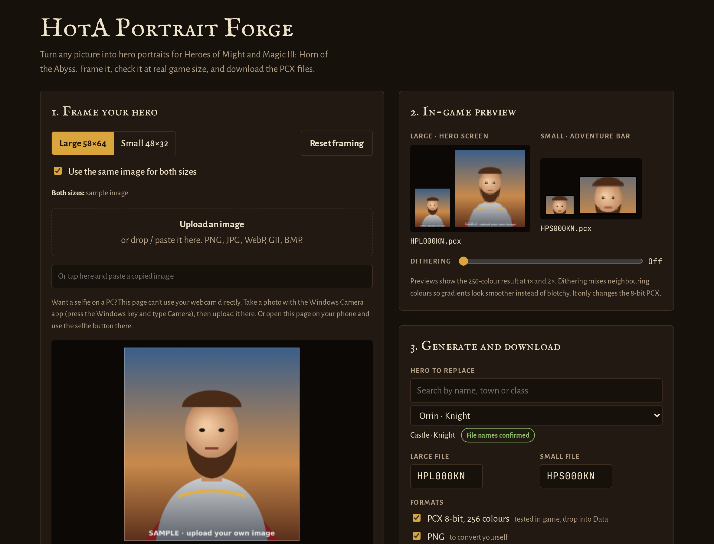

# HotA Portrait Forge

[](https://espenmjos.github.io/h3forge/)
[](LICENSE)

Turn any picture into hero portraits for **Heroes of Might and Magic III: Horn of the Abyss**.
Frame the image, check it at real game size, and download portrait files the game loads as-is.

**Use it online: <https://espenmjos.github.io/h3forge/>**



## Features

- **Large and small portraits**: 58×64 for the hero screen and 48×32 for the adventure-map hero bar,
  each framed separately.
- **True in-game preview**: see the 256-colour result at 1× and 2× before you export.
- **Optional dithering** for smoother gradients on photos.
- **Full HotA 1.8.1 hero list**, including Cove, Factory and Bulwark, with the correct file names
  filled in for you.
- **Game-ready output**: 8-bit PCX tested in game, plus PNG masters, in one ZIP.
- **Private by design**: everything runs in your browser. Images never leave your device.
- **Works anywhere**: desktop or phone, online or as a single offline HTML file. Nothing to install.

## Quick start

1. Open the [app](https://espenmjos.github.io/h3forge/).
2. Upload, drop or paste an image (or take a selfie on a phone).
3. Frame the **Large** and **Small** portraits.
4. Pick the hero to replace and click **Generate files**, then **Download ZIP**.
5. Copy the `.pcx` files into the game's `Data` folder (see [Installing](#installing-the-portraits)).

## Step-by-step guide

### 1. Frame your hero

Load an image in one of these ways:

- click **Upload an image**,
- drag and drop a file onto the box,
- paste an image from the clipboard (Ctrl+V, or the paste box on phones),
- on a phone, tap **Take a selfie**.

PNG, JPG, WebP, GIF and BMP are supported. The page opens with a sample so you can try the
controls first.

Use the **Large 58×64** and **Small 48×32** tabs to frame each size. Each size has its own
framing, so set both.

| Action | Mouse / touch | Keyboard |
| --- | --- | --- |
| Move | Drag | Arrow keys (one game pixel) |
| Zoom | Scroll, pinch or the **Zoom** slider | `+` / `-` |
| Start over | **Reset framing** | |

**Use the same image for both sizes** is on by default. Turn it off to use a different picture
for the small portrait, for example a tighter crop of the face.

No webcam support on PC: take a photo with the Windows Camera app and upload it, or use the
selfie button on your phone.

### 2. Check the in-game preview

The preview panel shows both portraits reduced to the game's 256 colours, at 1× and 2×.
**Dithering** mixes neighbouring colours so soft gradients look smoother instead of blotchy.
It only affects the 8-bit PCX.

### 3. Generate and download

1. **Hero to replace**: search by name, town or class. The file names (for example
   `HPL000KN.pcx` and `HPS000KN.pcx`) fill in automatically and can be edited by hand.
2. **Formats**:

   | Format | Default | Use |
   | --- | --- | --- |
   | PCX 8-bit, 256 colours | On | The files the game uses. Tested in game. |
   | PNG | On | Lossless masters for editing or converting yourself. |
   | H3 native 24-bit (experimental) | Off | Untested. Same file names as the 8-bit PCX, so back those up first. |

3. **1 px black border on the small portrait** matches the original small portraits. On by default.
4. Click **Generate files**, then **Download ZIP**.

## Installing the portraits

HotA installs into your existing *Heroes of Might and Magic III: Complete* folder, so the
portraits go into that folder's `Data` subfolder. With the GOG version this is by default:

```
C:\GOG Games\HoMM 3 Complete\Data
```

If you installed the game somewhere else, use `<your Heroes 3 folder>\Data`. The folder is the
one that contains `HotA_launcher.exe` and `h3hota HD.exe`.

1. Unzip the download.
2. Back up any files in `Data` with the same names.
3. Copy the `.pcx` files into `Data`.
4. Start HotA. The chosen hero now uses your portrait.

To undo, delete the files again (or restore your backup). As an alternative to loose files, you
can pack the portraits into a `.lod` archive with
[MMArchive](https://sites.google.com/site/sergroj/mm/mmarchive).

## Troubleshooting

| Problem | Cause and fix |
| --- | --- |
| Portrait shows random colours | You used a standard 24-bit image. Use the **PCX 8-bit** files. |
| Portrait does not change | The file name does not match the hero, or the files are in the wrong folder. Check that they are in the `Data` folder next to `HotA_launcher.exe`. |
| A HotA hero's small portrait does not change | Small file names for HotA heroes are derived, and Bulwark names are not published yet. Look up the real names in `HotA.lod` with MMArchive and type them into the name fields. |
| Other players see the original portrait | Custom portraits are local to your install. Share the files with them. |

## Technical notes

- Large portraits are 58×64 px (`HPL…`), small ones 48×32 px (`HPS…`). Both are PCX with at most
  256 colours.
- The 8-bit files never use palette entry 0. The game can treat that colour specially, so leaving
  it unused avoids graphic glitches.
- File names for the 156 original heroes are confirmed. For HotA heroes the large name is
  confirmed and the small name is derived from it.
- The whole app is one self-contained file, [`index.html`](index.html), with no build step and no
  dependencies besides optional web fonts.

## Running offline

Download [`index.html`](https://raw.githubusercontent.com/espenmjos/h3forge/main/index.html)
(right-click, *Save link as*) and open it in any modern browser. It works without an internet
connection, using fallback fonts.

## Contributing

Bug reports and corrections, especially verified HotA or Bulwark portrait file names, are welcome
via [issues](https://github.com/espenmjos/h3forge/issues).

## Disclaimer

This is an unofficial fan tool. It is not affiliated with Ubisoft or the Horn of the Abyss team.
Heroes of Might and Magic is a trademark of Ubisoft Entertainment.

## License

[MIT](LICENSE) © 2026 Espen Mjøs
